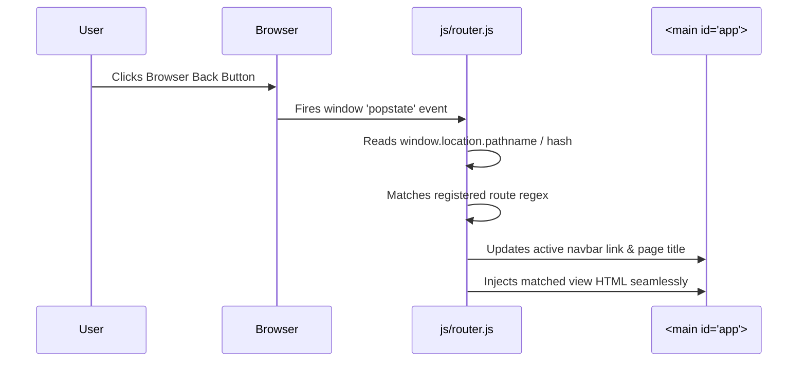

<div align="center">


# Smart College Website Portal
### Dr. D. Y. Patil College of Engineering (DYPCOE), Akurdi, Pune

**Web Technology 1 – CCE-5 Mini Project | Unit V: Single Page Application (SPA) Concepts**

[](https://developer.mozilla.org/en-US/docs/Web/HTML)
[](https://developer.mozilla.org/en-US/docs/Web/CSS)
[-F7DF1E?style=for-the-badge&logo=javascript&logoColor=black)](https://developer.mozilla.org/en-US/docs/Web/JavaScript)
[](https://www.json.org/)
[-2563EB?style=for-the-badge)](https://developer.mozilla.org/en-US/docs/Web/API/History_API)
[-10B981?style=for-the-badge)](#5-technologies-used)

*A complete, modern, responsive, and framework-free Single Page Application (SPA) built using HTML5, CSS3, Vanilla JavaScript, Fetch API, HTML5 History API, and LocalStorage.*

---


*Main Campus Entrance Gate — Dr. D. Y. Patil Educational Complex, Sector 29, Nigdi Pradhikaran, Akurdi, Pune - 411044*

</div>

---

## 📑 Table of Contents

1. [Project Title & Metadata](#1-project-title--metadata)
2. [Project Introduction](#2-project-introduction)
3. [Problem Identification (MPA vs. SPA)](#3-problem-identification-mpa-vs-spa)
4. [Project Objectives](#4-project-objectives)
5. [Technologies Used & Design System](#5-technologies-used--design-system)
6. [Complete Feature Walkthrough](#6-complete-feature-walkthrough)
7. [SPA Architecture & Routing Implementation](#7-spa-architecture--routing-implementation)
8. [JSON Data Architecture & Fetch API Workflow](#8-json-data-architecture--fetch-api-workflow)
9. [Client-Side Form Validation & LocalStorage](#9-client-side-form-validation--localstorage)
10. [Module-by-Module Code Explanation](#10-module-by-module-code-explanation)
11. [Project Folder Structure](#11-project-folder-structure)
12. [How to Run the Project](#12-how-to-run-the-project)
13. [Screenshots & Visual Showcase](#13-screenshots--visual-showcase)
14. [Testing & Quality Verification Checklist](#14-testing--quality-verification-checklist)
15. [Viva Voce Preparation Bank (CCE-5 Unit V)](#15-viva-voce-preparation-bank-cce-5-unit-v)
16. [Future Scope & Enhancements](#16-future-scope--enhancements)
17. [Institution & Academic Credits](#17-institution--academic-credits)

---

## 1. Project Title & Metadata

| Attribute | Details |
| :--- | :--- |
| **Project Title** | Smart College Website Portal – Dr. D. Y. Patil College of Engineering, Akurdi, Pune |
| **Course / Subject** | Web Technology 1 (CCE-5 – Continuous Comprehensive Evaluation) |
| **Unit / Topic** | Unit V: Single Page Application (SPA) Concepts |
| **Institution** | Dr. D. Y. Patil College of Engineering (DYPCOE), Akurdi, Pune – 411044 |
| **Official Reference** | [http://www.dypcoeakurdi.ac.in/](http://www.dypcoeakurdi.ac.in/) |
| **Principal** | Dr. Mrs. P. Malathi |
| **Affiliation & Approvals** | Savitribai Phule Pune University (SPPU) • AICTE Approved • DTE Code: **6272** • NAAC **'A'** Grade • NBA Accredited |
| **Academic Year** | 2026–2027 |

---

## 2. Project Introduction

The **Smart College Website Portal** is an individual engineering mini-project designed to demonstrate core **Single Page Application (SPA)** principles from scratch using **pure Vanilla JavaScript** — without relying on frontend frameworks such as React, Angular, Vue, jQuery, or Bootstrap.

Modeled after **Dr. D. Y. Patil College of Engineering (DYPCOE), Akurdi, Pune** (Established 1984 under Padma Shri Dr. D. Y. Patil), the portal provides students, parents, faculty, and prospective engineering aspirants with an intuitive, fast, and responsive digital gateway to explore:
- College heritage, accreditations, official Vision & Mission, and Principal's message (**Dr. Mrs. P. Malathi**)
- 6 Academic Engineering Departments with individual deep-dive views (laboratories, equipment, HOD profiles, achievements, and career paths)
- Undergraduate (B.Tech), Postgraduate (M.Tech), and Doctoral (Ph.D.) course catalog with live search and degree filtering
- Searchable and department-filterable Faculty Directory
- Categorized College Notice Board with priority alerts and circular reader modals
- Client-side validated Admission & Contact Enquiry Form backed by browser **LocalStorage**

Every single navigation transition occurs seamlessly inside `<main id="app">` without a full-page browser reload.

---

## 3. Problem Identification (MPA vs. SPA)

Traditional college websites are commonly built as static **Multi-Page Applications (MPAs)**, which suffer from several technical and user-experience bottlenecks:

| Aspect | Traditional Multi-Page College Site (MPA) | Smart College Portal (SPA Implementation) |
| :--- | :--- | :--- |
| **Page Navigation** | Triggers a full HTTP request and complete page reload on every click, causing white-screen flashes. | Intercepts clicks via JS, updates URL with `history.pushState()`, and swaps only `<main id="app">`. |
| **Bandwidth & Speed** | Re-downloads header, footer, CSS, logo, and scripts repeatedly on every view. | Shell (`index.html`, CSS, JS) loads **once**; only lightweight JSON data is fetched and cached in memory. |
| **Data Maintenance** | Hardcoded across dozens of separate `.html` pages, making updates error-prone. | Decoupled into 4 structured JSON files (`departments.json`, `courses.json`, `faculty.json`, `notices.json`). |
| **Search & Filtering** | Often requires page submission or server query reloads. | Instant, zero-latency client-side filtering and live keyword searching. |
| **Form Validation** | Validates only after form submission or via basic HTML alerts. | Real-time regex validation (`input`/`blur`), inline feedback, toast alerts, and LocalStorage persistence. |
| **Mobile Usability** | Static desktop tables and overflowing menus break on narrow screens. | Mobile-first responsive CSS Grid, Flexbox, and animated slide-in navigation drawer. |

---

## 4. Project Objectives

1. **Implement a Custom SPA Router:** Build a clean client-side router using the **HTML5 History API** (`pushState()`, `popstate`) supporting both static routes (`/about`, `/courses`) and dynamic parameterized routes (`/departments/:id`).
2. **Asynchronous Data Fetching:** Use the native **Fetch API** with `async/await`, loading spinners, in-memory caching, and graceful error recovery to load external JSON datasets.
3. **Dynamic DOM Manipulation:** Render cards, detail pages, search results, modals, toast notifications, and data tables dynamically via JavaScript template literals.
4. **Client-Side Validation & Persistence:** Implement strict JavaScript regular expression validation (email & 10-digit Indian mobile numbers) and persist valid enquiries in **LocalStorage**.
5. **Responsive Institutional UI/UX:** Craft a professional university portal adhering to modern design tokens (Navy Blue `#102A43`, Royal Blue `#2563EB`, Clean White `#FFFFFF`, Soft Gray `#F3F6FA`).
6. **Viva & Academic Readiness:** Maintain clean, modular, beginner-friendly, well-commented code with an interactive in-app **Viva Quick Guide** modal.

---

## 5. Technologies Used & Design System

### Core Technology Stack (100% Vanilla Web Standards)

| Layer | Technology | Role in Application |
| :--- | :--- | :--- |
| **Structure** | **HTML5** | Semantic shell (`<header>`, `<nav>`, `<main id="app">`, `<aside>`, `<footer>`) |
| **Presentation** | **CSS3** | Custom properties (`:root`), CSS Grid, Flexbox, keyframe animations, media queries |
| **Application Logic** | **Vanilla JavaScript (ES6+)** | Classes, IIFE modules, `async/await`, event delegation, RegExp, DOM API |
| **Client-Side Routing** | **HTML5 History API** | `window.history.pushState()`, `popstate` listener, regex URL parameter extraction |
| **Data Fetching** | **Fetch API** | Non-blocking retrieval of local `.json` files with promise-based error handling |
| **Data Storage** | **JSON** | Clean, structured datasets decoupled from presentation markup |
| **Client Persistence** | **Web Storage API (`localStorage`)** | Persisting submitted student enquiries across page refreshes |
| **Vector Graphics** | **SVG** | Custom scalable DYPCOE Akurdi college crest (`assets/icons/college-logo.svg`) |

### Visual Design System & Color Palette

| Token | Hex Code | Usage |
| :--- | :--- | :--- |
| `--primary-navy` | `#102A43` | Primary headings, institutional accents, dark cards |
| `--primary-navy-dark` | `#0B1D3A` | Top utility bar, hero overlays, footer background |
| `--secondary-blue` | `#2563EB` | Interactive buttons, active nav indicators, links, badges |
| `--accent-gold` | `#F59E0B` | Call-to-action highlights, key metrics, achievement icons |
| `--bg-main` | `#FFFFFF` | Main content canvas and elevated card surfaces |
| `--bg-light` | `#F3F6FA` | Alternating section backgrounds, input pills, metadata blocks |
| `--text-primary` | `#1E293B` | High-contrast body headings and primary text |
| `--text-muted` | `#64748B` | Captions, dates, secondary labels |
| `--color-success` | `#10B981` | Valid form borders, success toasts, checklist icons |
| `--color-danger` | `#EF4444` | Urgent notice banners, validation error alerts |

### Responsive Breakpoints

| Device Tier | Breakpoint | Layout Behavior |
| :--- | :--- | :--- |
| **Desktop** | `> 1024px` | Full sticky navbar, 2-col hero, 3–4 column card grids, 4-column footer |
| **Laptop / Large Tablet** | `<= 1024px` | Stacked hero grid, 2–3 column cards, 2-column footer |
| **Tablet** | `<= 768px` | Hamburger menu + slide-in drawer, single-column grids, stacked filter bars |
| **Mobile** | `<= 480px` | Full-width CTA buttons, compact header brand, horizontal notice date badges |

---

## 6. Complete Feature Walkthrough

### 1. Sticky Header, Top Utility Bar & Mobile Drawer
- **Top Utility Bar:** Displays DTE Code (`6272`), SPPU affiliation, NAAC `'A'` Grade, NBA accreditation, and quick click-to-call/email links.
- **Sticky Navigation Bar:** Features the custom SVG college logo, full institution name, 7 SPA routes (`Home`, `About`, `Departments`, `Courses`, `Faculty`, `Notices`, `Contact`), active-route underline highlighting, and scroll-triggered glassmorphism shadow.
- **Mobile Drawer:** Smooth slide-in side menu with blurred backdrop and Escape-key close support.

### 2. Home Page (`/`)
- **Dual-Column Hero Section:** Showcases the real **Akurdi Campus Entrance Gate** (`assets/images/campus-gate.jpg`) as both a stylized backdrop and a framed foreground campus card alongside key statistics (`40+ Years Legacy`, `1080+ Annual Intake`, `43 LPA Highest Package`, `15,000+ Global Alumni`).
- **Welcome & Principal's Desk:** Features the campus gate landmark, NAAC Grade `'A'` floating badge, and leadership message from **Principal Dr. Mrs. P. Malathi**.
- **Academic Highlights:** 6 cards covering AI & Cognitive Computing, Industry Hub Synergies, Research Centres, Startup Incubation, Digital Library, and Placements.
- **Departments Overview:** Live cards dynamically rendered from `data/departments.json`.
- **Latest Notices Widget:** Top 4 live circulars fetched from `data/notices.json`.
- **Why Choose DYPCOE:** 6 institutional pillars (Accreditations, Experiential Learning, BAJA/Formula Racing, Industry 4.0 CoE, Ph.D. Faculty, Career Training).
- **Interactive Campus Gallery:** Clickable photo grid (led by the Akurdi Campus Entrance Gate) opening a full-size preview modal.

### 3. About College Page (`/about`)
- Institution heritage since 1984 under Padma Shri Dr. D. Y. Patil.
- Dedicated **Principal's Desk** section featuring **Dr. Mrs. P. Malathi**.
- **Official Vision & Mission** sourced directly from [dypcoeakurdi.ac.in](http://www.dypcoeakurdi.ac.in/).
- 4 Accreditation cards (NAAC, NBA, AICTE, SPPU).
- 6 Campus Infrastructure & Facility cards (Central Library, 75+ Labs, Smart Classrooms, Sports Complex, Hostels, Innovation & Incubation Centre).

### 4. Departments Page (`/departments` & `/departments/:id`)
- Displays all **6 Engineering Departments**:
  1. Artificial Intelligence & Data Science (`aids`)
  2. Computer Engineering (`comp`)
  3. Information Technology (`it`)
  4. Mechanical Engineering (`mech`)
  5. Civil Engineering (`civil`)
  6. Electronics & Telecommunication (`entc`)
- Clicking **"View Details →"** navigates dynamically to `/departments/:id` without reloading, rendering:
  - Department stats banner (Annual Intake, Established Year, Labs count)
  - Department Overview, Vision & Mission
  - Specialized Laboratories with hardware/software equipment specs
  - Programs Offered under the branch
  - Student & Faculty Achievements
  - Head of Department (HOD) profile sidebar with message & email
  - Career Pathways tags and quick jump to Faculty Directory

### 5. Courses & Degrees Catalog (`/courses`)
- Dynamically lists **11 engineering programs** across **UG (B.Tech)**, **PG (M.Tech)**, and **Doctoral (Ph.D.)** levels.
- **Degree Filter Pills:** Instant filtering (`All Programs`, `Undergraduate`, `Postgraduate`, `Doctoral`).
- **Live Search Bar:** Real-time filtering by course title, department name, or keywords.
- **Syllabus & Eligibility Modal:** Detailed popup displaying duration, intake, tuition fee, admission eligibility, curriculum highlights, and career paths.

### 6. Faculty Directory (`/faculty`)
- Dynamically renders **14 faculty profiles** (including Principal **Dr. Mrs. P. Malathi** and department HODs/Professors).
- **Sample Data Notice Banner & Card Tags:** Clearly distinguishes sample academic demonstration profiles as required by the project specification.
- **Multi-Criteria Filtering:** Combine Department dropdown filtering with live keyword search (by name, designation, qualification, or research specialization).
- **Faculty Profile Modal:** Displays biography, academic experience, Scopus/IEEE publication count, courses handled, and official email link.

### 7. Notice Board & Circulars (`/notices`)
- **Urgent Notice Ticker:** Highlighted red alert bar for high-priority announcements.
- **Category Filter Pills:** Filter by `All Notices`, `Academic`, `Examination`, `Events`, `Admission`, and `Circulars`.
- **Keyword Search:** Instant search across notice titles, descriptions, and issuing authorities.
- **Circular Reader Modal:** Full circular text, issuing authority signature block, date, and simulated PDF download toast notification.

### 8. Contact & Validated Enquiry Page (`/contact`)
- Complete campus address, helpline numbers, official email addresses, office hours, and Google Maps link.
- **Real-Time Client-Side Validated Enquiry Form** with inline error messages, success toast notifications, and form reset.
- **LocalStorage Submission Log:** Live table displaying all client-side submitted enquiries saved in the browser, with a "Clear Saved Submissions" option.

### 9. Built-in Viva Quick Guide Modal
- Accessible from both the Hero section and the Site Footer (`💡 Viva Guide`), displaying a concise architectural summary of the SPA Router, Fetch API, and Validation rules for examiners during evaluation.

---

## 7. SPA Architecture & Routing Implementation

### SPA Navigation Lifecycle Flow

```mermaid
flowchart LR
    A["User Clicks Link (e.g. /courses)"] --> B["Global Click Delegation"]
    B --> C["e.preventDefault() (Blocks Reload)"]
    C --> D["router.navigateTo('/courses')"]
    D --> E{"Protocol Check"}
    E -- "HTTP / HTTPS" --> F["history.pushState(null, null, '/courses')"]
    E -- "file:///" --> G["window.location.hash = '/courses'"]
    F --> H["resolveCurrentRoute()"]
    G --> H
    H --> I["Regex Route Matching & Param Extraction"]
    I --> J["Update Active Nav & document.title"]
    J --> K["Show Loading Spinner"]
    K --> L["Async View Render + Fetch JSON"]
    L --> M["Inject HTML into <main id='app'>"]
    M --> N["Run afterRender() Event Listeners"]
```



### Browser Back / Forward Sequence (`popstate`)



### Registered SPA Route Table

| Route Pattern | View Handler | Dynamic Params | Post-Render Hook | Browser Title |
| :--- | :--- | :--- | :--- | :--- |
| `/` & `/home` | `app.renderHomePage()` | None | — | `Home \| D. Y. Patil College of Engineering, Akurdi` |
| `/about` | `app.renderAboutPage()` | None | — | `About Us \| D. Y. Patil College of Engineering, Akurdi` |
| `/departments` | `DepartmentsModule.renderDepartmentsPage()` | None | — | `Academic Departments \| DYPCOE Pune` |
| `/departments/:id` | `DepartmentsModule.renderDepartmentDetail(params)` | `params.id` (`aids`, `comp`, `it`, `mech`, `civil`, `entc`) | — | `Department Details \| DYPCOE Pune` |
| `/courses` | `CoursesModule.renderCoursesPage()` | None | `CoursesModule.initEvents()` | `Engineering Courses \| DYPCOE Pune` |
| `/faculty` | `FacultyModule.renderFacultyPage()` | None | `FacultyModule.initEvents()` | `Faculty Directory \| DYPCOE Pune` |
| `/notices` | `NoticesModule.renderNoticesPage()` | None | `NoticesModule.initEvents()` | `Notice Board & Circulars \| DYPCOE Pune` |
| `/contact` | `ValidationModule.renderContactPage()` | None | `ValidationModule.initEvents()` | `Contact & Admissions \| DYPCOE Pune` |
| *Any Unmatched Path* | `router.renderNotFound()` | None | — | `404 - Page Not Found \| DYPCOE` |

### Key Implementation Snippet (`js/router.js`)

```javascript
// Convert dynamic route pattern '/departments/:id' to RegExp
pathToRegex(path) {
  return new RegExp('^' + path.replace(/\//g, '\\/').replace(/:\w+/g, '([^\\/]+)') + '$');
}

// Intercept internal links without refreshing the page
document.addEventListener('click', (e) => {
  const target = e.target.closest('a');
  if (target && target.matches('[data-link]')) {
    e.preventDefault();
    this.navigateTo(target.getAttribute('href'));
  }
});

// Listen to browser Back / Forward buttons
window.addEventListener('popstate', () => {
  this.resolveCurrentRoute();
});
```

---

## 8. JSON Data Architecture & Fetch API Workflow

All dynamic institutional data is cleanly separated from JavaScript logic inside the `data/` directory. Each module uses the native **Fetch API** (`fetch()`) with **in-memory caching** so repeated route visits are instantaneous.

| JSON File | Records | Key Fields Stored |
| :--- | :---: | :--- |
| `data/departments.json` | 6 | `id`, `name`, `code`, `establishedYear`, `intake`, `vision`, `mission`, `hod`, `coursesOffered`, `laboratories`, `studentAchievements`, `careerOpportunities` |
| `data/courses.json` | 11 | `id`, `name`, `degreeLevel`, `degreeType`, `departmentId`, `duration`, `intake`, `feesPerYear`, `eligibility`, `description`, `highlights`, `careerPaths` |
| `data/faculty.json` | 14 | `id`, `name`, `designation`, `departmentId`, `department`, `qualification`, `experience`, `email`, `specialization`, `shortBio`, `photo`, `isSample`, `publicationsCount`, `coursesHandled` |
| `data/notices.json` | 8 | `id`, `title`, `category`, `date`, `author`, `isUrgent`, `shortDescription`, `fullText`, `attachment` |

### Sample JSON Structure (`data/notices.json`)

```json
{
  "id": "not-2026-001",
  "title": "SPPU In-Sem Examination Schedule - Term I (2026-27)",
  "category": "Examination",
  "date": "15 Nov 2026",
  "author": "Controller of Examinations",
  "isUrgent": true,
  "shortDescription": "Official timetable for Savitribai Phule Pune University (SPPU) in-semester theory examinations.",
  "fullText": "All students of Second Year, Third Year, and Final Year B.Tech are hereby notified...",
  "attachment": "SPPU_InSem_Exam_Schedule_2026.pdf"
}
```

### Dual-Mode Fetch Strategy (`HTTP` + `file:///` Compatibility)
When running over any HTTP server (Live Server, Python, Node, GitHub Pages), `fetch('data/<file>.json')` retrieves the live JSON file asynchronously. If an examiner double-clicks `index.html` directly from Windows Explorer (`file:///` protocol where browsers restrict local Fetch CORS requests), the module automatically detects the catch error and loads gracefully from `data/fallback-data.js` so the portal never fails during evaluation.

---

## 9. Client-Side Form Validation & LocalStorage

Implemented in `js/validation.js`, the Contact & Enquiry Form enforces strict real-time validation before accepting submissions.

### Validation Rules Matrix

| Field | HTML Type | Validation Rule / Regular Expression | Error Message |
| :--- | :--- | :--- | :--- |
| **Full Name** | `text` | Required, min 3 chars, `/^[a-zA-Z\s.]+$/` | *"Please enter a valid student name (at least 3 letters, alphabets only)."* |
| **Email Address** | `email` | Required, `/^[a-zA-Z0-9._%+-]+@[a-zA-Z0-9.-]+\.[a-zA-Z]{2,}$/` | *"Please enter a valid email address (e.g. student@example.com)."* |
| **Mobile Number** | `tel` | Required, 10-digit Indian format `/^[6-9]\d{9}$/` | *"Please enter a valid 10-digit Indian mobile number starting with 6, 7, 8, or 9."* |
| **Department** | `select` | Required, must not be empty (`""`) | *"Please choose an engineering department."* |
| **Enquiry Subject** | `text` | Required, minimum 4 characters | *"Please enter an enquiry subject (minimum 4 characters)."* |
| **Enquiry Message** | `textarea` | Required, minimum 15 characters | *"Please enter a detailed enquiry message (minimum 15 characters)."* |

### LocalStorage Persistence Format
Valid submissions are serialized to JSON and stored under the key `dypcoe_enquiries_list` (keeping up to 20 most recent submissions):

```json
[
  {
    "name": "Aarav Sharma",
    "email": "aarav.sharma@example.com",
    "phone": "9876543210",
    "department": "Computer Engineering",
    "subject": "B.Tech Admission Cutoff Inquiry",
    "message": "Please share MHT-CET cutoff details and hostel fee structure.",
    "date": "18 Nov 2026, 12:30 pm"
  }
]
```

> **Note:** As required by the CCE-5 project guidelines, this portal demonstrates client-side validation and browser `localStorage` persistence transparently without pretending to transmit data to an official college backend server.

---

## 10. Module-by-Module Code Explanation

| File | Pattern Used | Primary Responsibilities |
| :--- | :--- | :--- |
| `index.html` | Semantic HTML5 | Single shell containing top bar, sticky header, mobile drawer, `<main id="app">`, footer, global modal, toast container, and ordered script tags. |
| `css/style.css` | Custom CSS Design System | Variables, typography, responsive grids, card hover elevations, form `.is-valid`/`.is-invalid` states, toast/modal transitions, and 4 media query breakpoints. |
| `js/router.js` | ES6 `Router` Class | Registers routes, converts `:param` strings into regex, intercepts clicks, invokes `history.pushState()`, handles `popstate`, updates active links & `<title>`, manages loading/404/error views. |
| `js/app.js` | ES6 `App` Class | Bootstraps routes, renders Home & About views, manages sticky scroll effects, back-to-top button, mobile drawer, global modal, toast notification engine, gallery lightbox, and Viva Guide modal. |
| `js/departments.js` | IIFE Module Pattern | Fetches & caches `departments.json`, renders 6-branch grid, home overview widget, and full `/departments/:id` parametric detail page. |
| `js/courses.js` | IIFE Module Pattern | Fetches & caches `courses.json`, manages degree-level pill filters (`UG`, `PG`, `PhD`), live search input, and detailed course syllabus modal. |
| `js/faculty.js` | IIFE Module Pattern | Fetches & caches `faculty.json`, manages department dropdown filter, live search, sample data badges, and detailed faculty profile modal. |
| `js/notices.js` | IIFE Module Pattern | Fetches & caches `notices.json`, displays urgent notice ticker, category tabs, keyword search, home notices widget, and full circular reader modal. |
| `js/validation.js` | IIFE Module Pattern | Renders Contact page, binds `blur`/`input`/`submit`/`reset` validation listeners, enforces RegExp checks, persists records to `localStorage`, and updates live submission log table. |

---

## 11. Project Folder Structure

```text
WT CCE5/ (smart-college-portal)
│
├── index.html                      # Single Page Application entry shell
├── README.md                       # Complete GitHub & academic documentation
│
├── css/
│   └── style.css                   # Responsive stylesheet & visual theme
│
├── js/
│   ├── router.js                   # HTML5 History API SPA routing engine
│   ├── departments.js              # Departments grid & dynamic detail view
│   ├── courses.js                  # Courses catalog, filters & syllabus modal
│   ├── faculty.js                  # Faculty directory, filters & profile modal
│   ├── notices.js                  # Notice board, categories & circular reader
│   ├── validation.js               # Client-side form validation & LocalStorage
│   └── app.js                      # App bootstrap, Home/About views & UI helpers
│
├── data/
│   ├── departments.json            # 6 engineering branches structured JSON
│   ├── courses.json                # 11 UG/PG/Ph.D. courses structured JSON
│   ├── faculty.json                # 14 faculty & leadership profiles JSON
│   ├── notices.json                # 8 categorized notices & circulars JSON
│   └── fallback-data.js            # file:/// protocol offline fallback registry
│
└── assets/
    ├── icons/
    │   └── college-logo.svg        # Custom vector DYPCOE college crest
    └── images/
        └── campus-gate.jpg         # Real D. Y. Patil Akurdi entrance gate photo
```

---

## 12. How to Run the Project

### Option 1: VS Code Live Server (Recommended for Viva & Demo)
1. Open the project folder (`WT CCE5`) in **Visual Studio Code**.
2. Install the **Live Server** extension (by *Ritwick Dey*).
3. Right-click `index.html` and choose **"Open with Live Server"**.
4. The SPA launches at `http://127.0.0.1:5500/` with full HTML5 History API clean URLs and live `fetch()` requests visible in Chrome DevTools → Network tab.

### Option 2: Python Built-in HTTP Server
Open PowerShell / Terminal in the project directory and run:
```bash
python -m http.server 8000
```
Open your browser and navigate to `http://localhost:8000`.

### Option 3: Node.js Static Server
```bash
npx serve .
```
Open the local URL printed in your terminal (e.g., `http://localhost:3000`).

### Option 4: Direct Double-Click (`file:///`)
Double-click `index.html` directly in Windows File Explorer. The portal automatically uses hash-based routing (`#/departments`) and `data/fallback-data.js` so every feature still runs smoothly offline.

### Option 5: Deploy to GitHub Pages
1. Push this repository to GitHub.
2. Go to **Settings → Pages**.
3. Under **Source**, choose `Deploy from a branch` → select `main` and `/ (root)` → click **Save**.
4. Your Smart College Portal will be live on `https://<your-username>.github.io/<repo-name>/`.

---

## 13. Screenshots & Visual Showcase

### Campus Landmark Featured in Portal


### Recommended Screenshots to Capture for GitHub Submission
*(Take screenshots after opening the portal in your browser and save them inside `assets/images/` to replace the placeholders below)*:

| Page / Feature | Desktop View | Key Concept Highlighted |
| :--- | :--- | :--- |
| **Home Page (Hero & Stats)** | `assets/images/screen-home.png` | Campus gate hero, metrics bar, Principal's Desk |
| **Departments & Detail View** | `assets/images/screen-dept.png` | Dynamic `/departments/:id` SPA route, labs & HOD card |
| **Courses Filter & Modal** | `assets/images/screen-courses.png` | Live degree pills (`UG`/`PG`/`PhD`) + keyword search |
| **Faculty Directory** | `assets/images/screen-faculty.png` | Department filter + sample academic badges |
| **Notice Board & Reader** | `assets/images/screen-notices.png` | Urgent ticker + category filters + modal reader |
| **Contact Form & LocalStorage** | `assets/images/screen-contact.png` | Regex validation errors + LocalStorage submission table |
| **Mobile Responsive View** | `assets/images/screen-mobile.png` | Hamburger drawer & responsive single-column layout |

---

## 14. Testing & Quality Verification Checklist

| # | Test Case | Expected Result | Status |
| :-: | :--- | :--- | :-: |
| 1 | Click all 7 navbar links (`Home` → `Contact`) | Content updates inside `<main id="app">` with **zero page reload** | ✅ Passed |
| 2 | Click Browser **Back** and **Forward** buttons | Previous/next views restore cleanly via `popstate` event | ✅ Passed |
| 3 | Click **"View Details"** on any Department card | URL changes to `/departments/<id>` and loads labs, HOD, courses | ✅ Passed |
| 4 | Inspect Network tab on HTTP server | `departments.json`, `courses.json`, `faculty.json`, `notices.json` return HTTP `200 OK` | ✅ Passed |
| 5 | Filter Courses by `PG` and type `"VLSI"` | Dynamically narrows grid to *M.Tech in VLSI & Embedded Systems* | ✅ Passed |
| 6 | Filter Faculty by `Computer Engineering` | Shows only Computer Engineering faculty profiles | ✅ Passed |
| 7 | Filter Notices by `Examination` & click `Read More` | Shows exam circulars and opens official notice modal | ✅ Passed |
| 8 | Submit empty Enquiry Form | Highlights all 6 fields in red with specific inline error messages | ✅ Passed |
| 9 | Enter invalid email (`abc@test`) or 8-digit phone | Triggers regex validation errors immediately | ✅ Passed |
| 10 | Submit valid Enquiry Form & refresh page | Shows success toast and retains record in LocalStorage log table | ✅ Passed |
| 11 | Resize viewport to Mobile (`375px`) & Tablet (`768px`) | Hamburger menu appears, cards stack cleanly, no horizontal scroll | ✅ Passed |
| 12 | Check Browser DevTools Console | Zero uncaught JavaScript errors or syntax issues | ✅ Passed |

---

## 15. Viva Voce Preparation Bank (CCE-5 Unit V)

### Q1. What is a Single Page Application (SPA) and how does it differ from a traditional website?
> An SPA loads a single HTML document (`index.html`) once. Instead of asking the server for a brand-new HTML file on every click, JavaScript intercepts link clicks, fetches lightweight JSON data asynchronously, and dynamically updates only the main container (`<main id="app">`). This eliminates white-screen reloads and makes navigation feel instant.

### Q2. Explain the role of `history.pushState()` and the `popstate` event in your project.
> - `history.pushState(state, title, url)` modifies the browser's URL bar and adds an entry to the session history stack **without triggering a page refresh**.
> - `window.addEventListener('popstate', ...)` listens for when the user clicks the browser's Back or Forward button, allowing `router.resolveCurrentRoute()` to re-render the view matching the restored URL.

### Q3. How do you prevent default page reloads when a user clicks a navigation link?
> We use **Event Delegation** on `document` in `js/router.js`. When a click bubbles up from an internal `<a href="..." data-link>` tag, we call `e.preventDefault()` to stop the browser from navigating normally, and then call `router.navigateTo(href)`.

### Q4. How does your router handle dynamic URLs like `/departments/comp` or `/departments/aids`?
> `pathToRegex()` converts `/departments/:id` into the regular expression `/^\/departments\/([^\/]+)$/`. When the URL matches, `getParams()` extracts the captured segment (`id = "comp"`), passes `{ id: "comp" }` to `DepartmentsModule.renderDepartmentDetail(params)`, and renders that specific department from `departments.json`.

### Q5. Why did you store college data in JSON files instead of hardcoding it in HTML?
> Separating data into `departments.json`, `courses.json`, `faculty.json`, and `notices.json` follows **Separation of Concerns**. It keeps HTML clean, mirrors real-world REST API responses, makes updates effortless (adding a notice or course requires editing only JSON), and demonstrates asynchronous DOM rendering via the Fetch API.

### Q6. Explain how the Fetch API works in your modules.
> `fetch('data/departments.json')` returns a `Promise` that resolves to a `Response` object. Using `async/await`, we check `response.ok` to catch HTTP errors, call `await response.json()` to parse the JSON payload into JavaScript objects, cache it in memory, and map the array into HTML cards.

### Q7. How do you handle loading states and errors during data fetching?
> Before awaiting an async route view, `router.renderLoading()` displays a CSS animated spinner inside `#app`. If `fetch()` throws an error or returns a non-OK HTTP status, the `try/catch` block catches it and either activates the offline fallback registry (`file:///`) or renders a friendly error UI with a **"Retry Loading"** button.

### Q8. What regular expressions did you use for form validation in `js/validation.js`?
> - **Name:** `/^[a-zA-Z\s.]+$/` (alphabets, spaces, dots; min 3 characters)
> - **Email:** `/^[a-zA-Z0-9._%+-]+@[a-zA-Z0-9.-]+\.[a-zA-Z]{2,}$/` (standard email format)
> - **Indian Mobile Number:** `/^[6-9]\d{9}$/` (exact 10 digits starting with 6, 7, 8, or 9)

### Q9. How is `localStorage` used in the Contact & Enquiry page?
> When the form passes all validation checks, the enquiry object (along with a formatted Indian timestamp) is prepended to an array, serialized with `JSON.stringify()`, and stored via `localStorage.setItem('dypcoe_enquiries_list', ...)`. On page load or submission, `JSON.parse(localStorage.getItem(...))` retrieves the records to render the live **Submitted Enquiries Log** table.

### Q10. Why did you use the IIFE (Immediately Invoked Function Expression) pattern in modules like `departments.js` and `courses.js`?
> Wrapping each module inside `const CoursesModule = (function () { ... })()` encapsulates private state variables (like `coursesCache`, `activeFilter`, `searchQuery`) so they do not pollute the global `window` scope, while exposing only clean public methods.

---

## 16. Future Scope & Enhancements

- **Backend Integration:** Connect the Enquiry Form and Notice Board to a Node.js/Express + MongoDB or Firebase REST API for real-time administrative updates.
- **Student ERP & Login Portal:** Add role-based authentication (JWT) for attendance tracking, internal marks, and timetable downloads.
- **Dark Mode Toggle:** Persist theme preference (`light` / `dark`) in `localStorage` using CSS custom properties.
- **Progressive Web App (PWA):** Add a `manifest.json` and Service Worker for installable mobile app experience and offline caching.
- **AI Campus Chatbot:** Integrate an FAQ assistant for quick admission cutoff and scholarship queries.

---

## 17. Institution & Academic Credits

- **College:** Dr. D. Y. Patil College of Engineering (DYPCOE), Akurdi, Pune – 411044
- **Official College Portal:** [http://www.dypcoeakurdi.ac.in/](http://www.dypcoeakurdi.ac.in/)
- **Course:** Web Technology 1 (CCE-5) — Unit V: Single Page Application (SPA) Concepts
- **License:** Developed for educational, practical demonstration, and portfolio purposes.

---

<div align="center">

**Built with ❤️ using Pure HTML5, CSS3 & Vanilla JavaScript for Web Technology 1 (CCE-5)**

</div>
